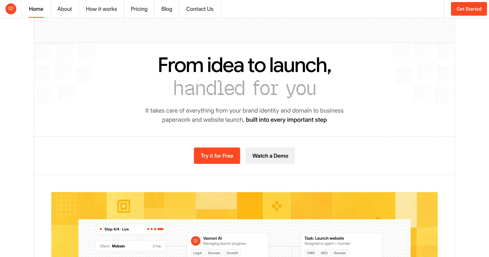
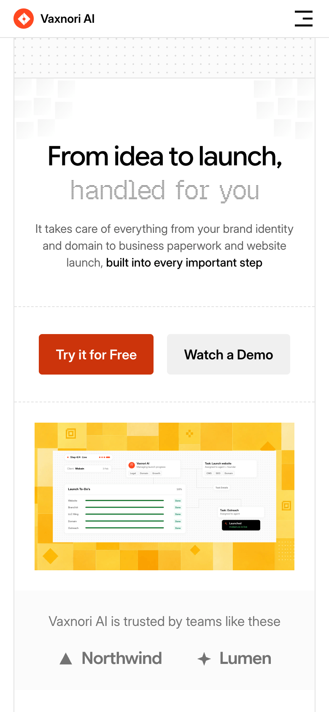

# Vaxnori AI – Next.js AI SaaS Template

A free, open-source Next.js (App Router) template for AI and SaaS products: 13 pages, smooth Motion animations, MDX blog and careers, and a design that is easy to rebrand from one config folder.



[](https://vercel.com/new/clone?repository-url=https%3A%2F%2Fgithub.com%2FWavespaceAgency%2Fvaxnori-nextjs-template&project-name=vaxnori-nextjs-template&repository-name=vaxnori-nextjs-template)

**Live demo:** https://vaxnori-ai.vercel.app

No environment variables, no database and no paid services are needed to deploy.

---

## Features

**Pages**

| Page | What's on it |
| --- | --- |
| Home | Animated product preview, logo marquee, product tabs, stats, how it works, testimonial, feature rows, integrations, FAQ |
| About | Principles, story timeline, stats, team |
| How it works | Video block (opens in a dialog), step-by-step rows, FAQ |
| Pricing | Monthly / annual switch, plan cards, comparison table, FAQ |
| Blog + post | Category filter, "load more", reading layout with "On this page", related posts |
| Careers + job | Tabs, open roles, benefits, hiring process, job page with compensation card |
| Contact | Contact channels, validated form (Server Action), locations |
| FAQ, Privacy, Terms, 404 | Grouped accordion, legal pages with a sticky contents list |

**Built with**

- **Next.js 16** App Router, React Server Components, Cache Components – every page is static
- **TypeScript** (strict), **Tailwind CSS 4**, ESLint
- **Motion** for animations (loaded asynchronously) – all animations respect "reduce motion"
- **MDX** for blog posts, job posts and legal pages
- **next/font** (Inter, Google Sans Flex, Geist Pixel – all SIL Open Font License, self-hosted at build)
- **next/image** with WebP/AVIF and 2–4× sources for sharp screens

**Quality**

- Lighthouse (mobile): Performance 93–99, Accessibility 100, Best Practices 100, SEO 100
- 0 axe-core violations (WCAG 2.1 AA) on every page; full keyboard support, skip link, visible focus
- SEO: metadata on every page, canonical URLs, `sitemap.xml`, `robots.txt`, generated Open Graph images (one per blog post),
  JSON-LD (Organization, WebSite, FAQPage, BlogPosting, JobPosting)
- Responsive from 320 px to 1920 px, no horizontal scroll



---

## Getting started

Requirements: **Node.js 20.9 or newer** (see `.nvmrc`).

```bash
git clone https://github.com/WavespaceAgency/vaxnori-nextjs-template.git
cd vaxnori-nextjs-template
npm install
npm run dev
```

Open http://localhost:3000.

| Command | What it does |
| --- | --- |
| `npm run dev` | Start the development server |
| `npm run build` | Create a production build |
| `npm run start` | Run the production build |
| `npm run lint` | Check the code with ESLint |

---

## Customisation guide

You can rebrand the whole template without touching the components.

### 1. Site name, links and footer – `src/config/site.ts`

Name, legal name, description, email, navbar links, mobile menu, footer columns, social links, the main call to action and the two brand marks.

### 2. Page text and data – `src/config/pages/*.ts`

One file per page: `home.ts`, `about.ts`, `how-it-works.ts`, `pricing.ts`, `blog.ts`, `careers.ts`, `contact.ts`, `faq.ts`.
Every heading, paragraph, button, plan, price, FAQ answer and image path lives here.
The animated mockups (hero preview, step cards, feature rows) are also driven by these files – change the labels,
numbers and steps in `home.ts`.

### 3. Colours, type and spacing – `src/app/globals.css`

All design tokens are CSS variables at the top of the file:

```css
--brand: #ff4820;        /* decorative orange: shapes, icons, fills */
--brand-strong: #cc340b; /* buttons and small orange text (passes 4.5:1 contrast) */
--ink: #000000;          /* headings */
--muted: #5e5e5e;        /* body text */
--canvas: #fbfbfb;       /* light section background */
--line: #e3e3e3;         /* borders */
```

Change them and the whole site follows. The type scale, radii, shadows and container width are in the `@theme` block below.

### 4. Fonts – `src/app/fonts.ts`

Swap any `next/font/google` import and keep the `variable` name (`--font-inter`, `--font-google-sans-flex`, `--font-geist-pixel`).

### 5. Images and logos – `public/`

| Folder | Contents |
| --- | --- |
| `public/brand/` | `mark.svg` (desktop) and `mark-alt.svg` (mobile, stats) |
| `public/images/` | Page images, grouped by page |
| `src/app/icon.svg` | Favicon |

The placeholder customer logos on Home are drawn in code – replace `homePage.logos` in `src/config/pages/home.ts`.

### 6. Add a blog post

Create `src/content/blog/my-post.mdx`:

```mdx
export const meta = {
  title: "My first post",
  excerpt: "One or two sentences for the card and search engines.",
  category: "Launch playbooks", // one of the tabs in src/config/pages/blog.ts
  date: "2026-10-01",
  readingTime: "4 min read",
  image: "/images/blog/my-post.webp", // 1456×800 works best
  imageAlt: "Describe the image",
  author: { name: "Your Name", avatar: "/images/blog/author.webp" },
};

Write your post in **Markdown**. Use `## Headings` – they appear in "On this page".
```

The file name becomes the URL (`/blog/my-post`). The post is added to the blog list, the sitemap and gets its own share image automatically.
Set `featured: true` to show it at the top of the blog page. In MDX you can also use `<Figure>`, `<Callout>` and `<Timeline>`.

### 7. Add a job

Copy any file in `src/content/careers/`, rename it (the file name is the URL) and edit `meta` and the text. It appears in the roles table automatically.

### 8. Legal pages

Edit `src/content/legal/privacy.mdx` and `terms.mdx`. The sample text is a placeholder – have it reviewed by your own lawyer.

### 9. Forms

The contact form and the newsletter form are validated in the browser and on the server, then handled by Server Actions in
`src/lib/actions.ts`. They only log the data. Look for `TODO` and connect your provider (Resend, Postmark, HubSpot, Mailchimp, a Slack webhook, …).

### 10. Video

Add an `.mp4` file (for example `public/videos/demo.mp4` → `"/videos/demo.mp4"`) or a YouTube/Vimeo embed URL
(`https://www.youtube.com/embed/VIDEO_ID?autoplay=1`) to `src` in `src/config/demo-video.ts`.
Every "Watch a Demo" button (Home and How it works) and the video block on How it works open this video in a popup.
The sample video in `public/videos/` is a screen recording of this template – replace it with your own.
While `src` is empty, the popup shows a "coming soon" note. The video only loads when someone opens it.

### 11. Site URL

On Vercel the production URL is detected automatically. Set `NEXT_PUBLIC_SITE_URL` only if you use a custom domain somewhere else.

---

## Project structure

```
src/
  app/                  Routes: pages, layout, sitemap, robots, manifest, OG images, 404
    blog/[slug]/        Blog post (+ its share image)
    careers/[slug]/     Job post
  components/
    layout/             Navbar, mobile menu, footer, newsletter form
    sections/           Page sections (hero, pricing, FAQ, CTA, animated mockups, …)
    blog/ careers/ contact/
    motion/             Reveal, stagger, rolling numbers, loops, scale-to-fit
    ui/                 Button, container, badge, heading, accordion, inputs, logo
    icons/              Brand marks and line icons
  config/
    site.ts             Name, URL, navigation, footer, socials
    pages/*.ts          Text and data for every page
  content/
    blog/*.mdx          Blog posts
    careers/*.mdx       Job posts
    legal/*.mdx         Privacy and terms
  lib/                  Content loader, metadata helper, Server Actions, OG image, utils
  mdx-components.tsx    Styles and components for MDX
public/                 Images, brand marks, README previews
DECISIONS.md            Design and build notes (what changed from the Figma file and why)
```

---

## Credits

- **Design:** Vaxnori AI by [Wavespace](https://www.wavespace.agency)
- **Fonts:** [Inter](https://fonts.google.com/specimen/Inter), [Google Sans Flex](https://fonts.google.com/specimen/Google+Sans+Flex),
  [Geist Pixel](https://fonts.google.com/specimen/Geist+Pixel) – SIL Open Font License 1.1
- **Images:** AI-generated or made by Wavespace for this template – free to use with the template
- **Icons:** custom line icons in `src/components/icons/`
- **Demo video:** `public/videos/vaxnori-demo.mp4` is a screen recording of this template made by Wavespace – free to use with the template
- **Customer logos:** neutral placeholders (Acme, Logoipsum, …) – not real companies

**Footer credit:** the footer shows "Designed & developed by Wavespace". You are free to keep, change or remove it –
edit or delete `credit` in `siteConfig.footer` (`src/config/site.ts`). The MIT license only asks you to keep the
`LICENSE` file, not the footer line.

All names, numbers, quotes and people in the sample content are fictional.

## License

[MIT](LICENSE) © 2026 Wavespace
